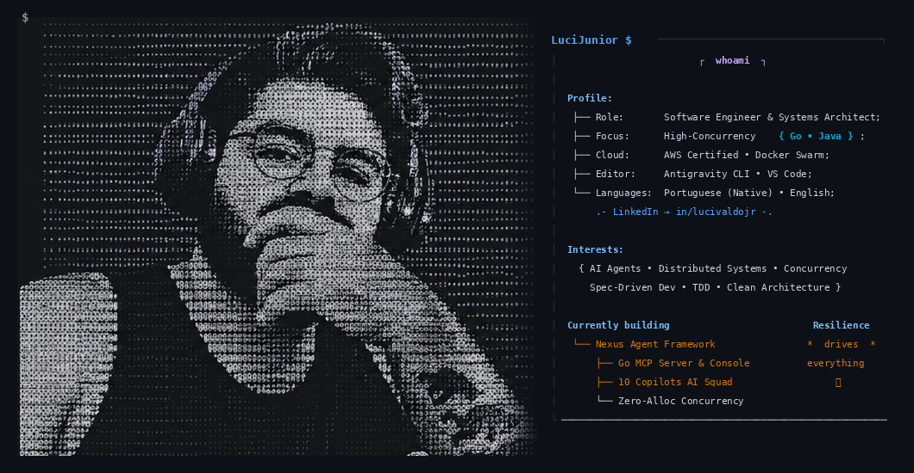

<div align="center">

# 🌌 Nexus Agent Framework

### *Framework Open Source de Orquestração de Agentes Autônomos, MCP e Squad de Engenharia em Go Nativo*

[](https://ubuntu.com/)
[](https://github.com/luci-jr/nexus-agent-framework)
[](https://go.dev/)
[](LICENSE)
[](https://modelcontextprotocol.io/)
[](https://github.com/luci-jr/nexus-agent-framework)
[](https://github.com/luci-jr/nexus-agent-framework/pulls)

<p align="center">
  <a href="#-1-o-que-é-o-nexus-agent-framework">O Que É</a> •
  <a href="#-2-arquitetura-do-sistema">Arquitetura</a> •
  <a href="#-3-estrutura-de-diretórios-consolidada">Estrutura</a> •
  <a href="#-4-o-squad-de-copilotos-especialistas">Squad</a> •
  <a href="#-5-catálogo-do-servidor-mcp-nativo">MCP Tools</a> •
  <a href="#-6-trilha-de-tutoriais-oficiais-onboarding">Tutoriais</a> •
  <a href="#-7-acesso-remoto-pelo-celular-custo-zero">Acesso Móvel</a> •
  <a href="#-8-quickstart-em-3-minutos">Quickstart</a> •
  <a href="#-autor--arquiteto">Autor</a>
</p>

</div>

---

## 🧭 1. O Que É o Nexus Agent Framework?

O **Nexus Agent Framework** é uma plataforma open-source de alta performance projetada para desenvolvedores, tech leads e solopreneurs que utilizam Modelos de Linguagem (LLMs) como **Anthropic Claude Code**, **Google Antigravity CLI**, **Cursor IDE**, **VS Code** e **Gemini**.

Diferente de frameworks tradicionais que dependem de centenas de megabytes de dependências Python ou Node.js, o Nexus foi concebido sob o princípio da **homogeneidade e leveza em Go**:

* ⚡ **Ultra Leve & Baixo Consumo (< 20 MB de RAM):** Construído 100% em Go 1.22+ puro, com tempo de inicialização de milissegundos e sem necessidade de máquinas pesadas.
* 📦 **Binário Único & Auto-Contido:** O frontend do Dashboard Web (Single Page App em Vanilla JS + Tailwind CSS) é compilado diretamente dentro do binário executável via `//go:embed`.
* 🔌 **Model Context Protocol (MCP) Nativo:** Expõe ferramentas seguras de auditoria de código, verificação de critérios de aceite (*DoD*), status de infraestrutura e memória local via canal `stdio`.
* 👥 **Squad Especialista Integrado:** 10 copilotos com instruções de engenharia disciplinadas (TDD estrito, Clean Architecture, Uncle Bob e Spec-Driven Development).
* 📱 **PWA & Acesso Remoto Gratuito:** Acesse o console pelo celular no 4G/5G com **Tailscale** ou **Cloudflare Tunnel** com custo zero e sem abrir portas no roteador.

---

## 🏛️ 2. Arquitetura do Sistema

```text
                           ┌────────────────────────────────────────┐
                           │       DESENVOLVEDOR NO TERMINAL        │
                           │     (Linux Ubuntu • macOS • WSL2)      │
                           └──────────────────┬─────────────────────┘
                                              │
                                              ▼
                           ┌────────────────────────────────────────┐
                           │   CLIENTE DE IA (Claude • AGY • Cursor)│
                           │     Model Context Protocol (MCP) v3.1  │
                           └──────────────────┬─────────────────────┘
                                              │ Canal stdio (JSON-RPC 2.0)
                                              ▼
                           ┌────────────────────────────────────────┐
                           │      ⚡ SERVIDOR MCP NEXUS (Go puro)    │
                           │     Cache RAM <0.1ms • Ferramentas DoD │
                           └──────────────────┬─────────────────────┘
                                              │
         ┌────────────────────────────────────┼────────────────────────────────────┐
         │                                    │                                    │
         ▼                                    ▼                                    ▼
┌──────────────────┐                 ┌──────────────────┐                 ┌──────────────────┐
│   👥 agents/     │                 │   🎯 skills/     │                 │ 🖥️ nexus-console │
│                  │                 │                  │                 │                  │
│ Squad Especialista                 │ Engenharia &     │                 │ Dashboard Web Go │
│ 10 Copilotos     │                 │ Padrões de Código│                 │ Porta 8090       │
│                  │                 │                  │                 │                  │
│ • Lucy (Lead)    │                 │ • TDD & CleanCode│                 │ • Telemetria Go  │
│ • Backend (Go/Jv)│                 │ • Go Concurrency │                 │ • Task Tracker   │
│ • Frontend (Ang) │                 │ • Angular Signals│                 │ • Status Squad   │
│ • QA & SecOps    │                 │ • Spring Boot 3  │                 │ • PWA Mobile     │
└──────────────────┘                 └──────────────────┘                 └──────────────────┘
```

---

## 📂 3. Estrutura de Diretórios Consolidada

A árvore abaixo reflete a organização modular do repositório:

```text
nexus-agent-framework/
├── 👥 agents/              # Catálogo de Personas do Squad (10 Copilotos Especialistas)
│   ├── lucy.md             # Lucy: Tech Lead Sênior, Mentora Socrática & Arquiteta
│   ├── backend.md          # Go 1.22+, Java 21, Spring Boot 3, Redis & PostgreSQL
│   ├── frontend.md         # Angular 21+, Signals, TypeScript, CSS3 e Design Systems
│   ├── sysops.md           # Linux Ubuntu, Docker Swarm, Traefik v3, Redes e Nuvem
│   ├── qa.md               # Engenheiro de Qualidade, JUnit 5, Playwright e k6
│   ├── secops.md           # DevSecOps, Segurança da Informação, SCA/SAST e CVEs
│   ├── suporte.md          # Suporte Técnico N2/N3, Automação Comercial e SQL
│   ├── bi.md               # Business Intelligence, SQL Analítico e Métricas
│   ├── finops.md           # Cloud FinOps, Arbitragem Multi-Cloud e Gestão de TCO
│   ├── frellas.md          # Consultor de Carreira, ATS Score e Propostas PJ
│   └── webmaster.md        # CMS, WordPress, WooCommerce e Landing Pages
│
├── ⚡ nexus-mcp/            # Servidor MCP v3.1 em Go Nativo
│   ├── internal/           # Ferramentas nativas, telemetria e governança
│   ├── main.go             # Ponto de entrada do protocolo via canal stdio
│   ├── go.mod & go.sum     # Gerenciamento de dependências Go puras
│   └── Makefile            # Automações de compilação e testes unitários
│
├── 🖥️ nexus-console/        # Dashboard Web de Governança em Go Nativo (Porta 8090)
│   ├── internal/           # Parsers de markdown, bridge de telemetria e SSE
│   ├── web/                # Single Page App (Tailwind CSS, Lucide Icons, Vanilla JS)
│   ├── main.go             # Ponto de entrada do serviço HTTP local com //go:embed
│   ├── Dockerfile          # Empacotamento em container minimalista (<15MB RAM)
│   └── Makefile            # Compilação e execução rápida
│
├── 🎯 skills/              # Biblioteca de Habilidades Especializadas de Engenharia
│   ├── angular-signals-architect  # Reatividade em Angular 21+ com Signals e Standalone
│   ├── docker-swarm-traefik-ops   # Operação de Swarm, Traefik, redes overlay e proxy
│   ├── go-concurrency-patterns    # Concorrência em Go 1.22+, goroutines e mutexes
│   ├── postgres-data-engineering  # Concorrência transacional, query tuning e locks
│   ├── spring-boot-enterprise     # Padrões corporativos Java 21 LTS e Spring Boot 3
│   ├── ub-mode                    # Disciplina estrita de Clean Code e TDD (Uncle Bob)
│   ├── skill-builder              # Forjador de Agent Skills sob a Regra dos 3X
│   └── premium-ui-landing-page    # Design System e landing pages de alta conversão
│
├── 📁 docs/                # Documentação e Tutoriais Oficiais
│   ├── tutoriais/          # Trilha de onboarding passo a passo
│   │   ├── 01_instalacao_e_setup_local.md         # Setup do zero em 3 minutos
│   │   ├── 02_conectando_ao_seu_agente.md         # Conexão MCP (Claude, Cursor, AGY)
│   │   ├── 03_usando_o_squad_de_especialistas.md  # Orquestração do squad e prompts
│   │   └── 04_acesso_remoto_celular_gratuito.md   # Acesso 4G/5G com Tailscale
│   └── assets/             # Assets e cards visuais do framework
│
├── ⚙️ .mcp.json            # Manifesto de registro MCP portátil (caminho relativo)
├── 📄 .env.example         # Modelo de variáveis de ambiente configuráveis
├── 📜 Makefile             # Orquestrador mestre (make build, make run-console, make test)
├── 🔒 LICENSE              # Licença MIT Oficial
└── 📄 README.md            # Este documento mestre unificado
```

---

## 👥 4. O Squad de Copilotos Especialistas

O framework fornece **10 agentes especialistas prontos para uso**. Cada copiloto possui diretrizes rigorosas para atuar dentro do seu domínio técnico, eliminando alucinações e dispersão de escopo:

| Copiloto | Stack Principal | Foco de Atuação |
| :---: | :--- | :--- |
| 🧠 **Lucy** | Tech Lead & Orquestradora | Governança arquitetural, mentoria socrática, P.O. e validação de DoD |
| ☕ **Backend** | Go 1.22+ • Java 21 • Spring Boot 3 | Microsserviços concorrentes, APIs corporativas, Redis e PostgreSQL |
| 🅰️ **Frontend** | Angular 21+ • Signals • Standalone | Interfaces reativas sem zone.js, componentes standalone e UX |
| 🧪 **QA** | Playwright • JUnit 5 • Testcontainers | Pirâmide de testes automatizados, testes de carga e confiabilidade |
| 🛡️ **SecOps** | DevSecOps • SCA/SAST • CVEs | Auditoria de dependências, sanitização e blindagem de segurança |
| 🐧 **SysOps** | Linux Ubuntu • Docker Swarm • Traefik | Redes overlay, proxy reverso, systemd e infraestrutura |
| 📊 **BI** | PostgreSQL • SQL Analítico | Dashboards operacionais, relatórios executivos e métricas |
| 💰 **FinOps** | Multi-Cloud • AWS • OCI • TCO | Gestão financeira de nuvem, arbitramentos e corte de ociosidade |
| 🎫 **Suporte** | N2/N3 • Automação Comercial • SQL | Sustentação, resolução de incidentes e conciliação de dados |
| 💼 **Frellas** | Tech Recruiter • ATS Score • Pitch | Triagem de propostas, adequação de CV e contratos PJ |

---

## ⚡ 5. Catálogo do Servidor MCP Nativo

O **Nexus MCP Server** implementa o protocolo oficial da Anthropic (*Model Context Protocol*), fornecendo ao seu LLM acesso a ferramentas determinísticas de engenharia:

| Ferramenta | Descrição |
| :--- | :--- |
| `nexus_status_sistema` | Inspeciona CPU, RAM livre/usada, uptime e integridade do runtime Go. |
| `nexus_validar_dod` | Audita se uma entrega de código atende 100% aos critérios de aceite (*Definition of Done*). |
| `nexus_auditar_comando`| Analisa comandos de terminal antes de executá-los para evitar riscos de segurança. |
| `nexus_listar_adrs` | Consulta o índice de Architecture Decision Records do projeto. |
| `nexus_obter_estado_tarefa` | Lê as tarefas ativas, backlog e concluídas diretamente do Markdown. |
| `nexus_auditar_impacto` | Grafo de dependências para análise de raio de impacto de código. |

---

## 📚 6. Trilha de Tutoriais Oficiais (Onboarding)

Preparamos uma trilha mastigada passo a passo para você dominar o framework em minutos:

* 📖 **[Tutorial 01: Instalação e Setup Local do Zero](docs/tutoriais/01_instalacao_e_setup_local.md)**
  *Pré-requisitos mínimos, compilação com 1 comando e inicialização do console.*
* 🔌 **[Tutorial 02: Conectando o Nexus MCP aos seus Agentes](docs/tutoriais/02_conectando_ao_seu_agente.md)**
  *Configuração no Claude Code, Antigravity CLI, Cursor IDE e Claude Desktop.*
* 👥 **[Tutorial 03: Orquestrando o Squad de Agentes Especialistas](docs/tutoriais/03_usando_o_squad_de_especialistas.md)**
  *Fluxo de Spec-Driven Development (TDD + Clean Code) e prompts reais prontos.*
* 📱 **[Tutorial 04: Acesso Remoto no Celular Fora de Casa (100% Gratuito)](docs/tutoriais/04_acesso_remoto_celular_gratuito.md)**
  *Como conectar seu celular via 4G/5G com Tailscale ou Cloudflare Tunnel sem abrir portas.*

---

## 📱 7. Acesso Remoto pelo Celular (Custo Zero)

Acesse o **Nexus Web Console** no smartphone quando estiver na rua ou viajando:

1. **Instale o Tailscale no PC:** `curl -fsSL https://tailscale.com/install.sh | sh && sudo tailscale up`
2. **Abra no Celular:** Baixe o app Tailscale, ative a conexão e acesse `http://100.x.y.z:8090`.
3. **PWA Instalável:** Toque em *"Adicionar à tela de início"* no navegador do celular — ele passa a abrir em tela cheia com ícone dedicado como um app nativo de smartphone!

---

## 🚀 8. Quickstart em 3 Minutos

```bash
# 1. Clonar o repositório:
git clone https://github.com/luci-jr/nexus-agent-framework.git
cd nexus-agent-framework

# 2. Compilar os binários otimizados (Console Web & Servidor MCP):
make build

# 3. Executar o Nexus Web Console (Dashboard na porta 8090):
make run-console

# 4. Executar os testes automatizados para validar sua máquina:
make test
```

---

## 📜 Licença

Distribuído sob a licença **MIT**. Consulte [`LICENSE`](LICENSE) para mais detalhes.

---

## 👨‍💻 Autor & Arquiteto

<div align="center">



</div>

<br/>

<div align="left">

**Lucivaldo Junior (Luci Junior)**  
*Engenheiro de Software Back-end & Arquiteto de Sistemas | Belém do Pará — Amazônia, Brasil*

> *"Da pressão contínua das cozinhas profissionais por mais de 15 anos para a engenharia de software de alta performance: trago a disciplina operacional da gastronomia, a calma sob pressão e o foco intransigente em entregar sistemas sólidos, leves e que resolvem problemas reais."*

* **Stack Principal:** Go (Golang 1.22+) • Java 21 (Spring Boot 3) • PostgreSQL • Docker & Swarm • Nuvem AWS (AWS Certified)
* **Ecossistema:** Criador do **Nexus Ecosystem** & **Nexus Agent Framework**

---

### 🌐 Conecte-se Comigo

[](https://linkedin.com/in/lucivaldojr)
[](https://github.com/luci-jr)
[](https://portifolio.lucivaldo.cloud)

</div>
